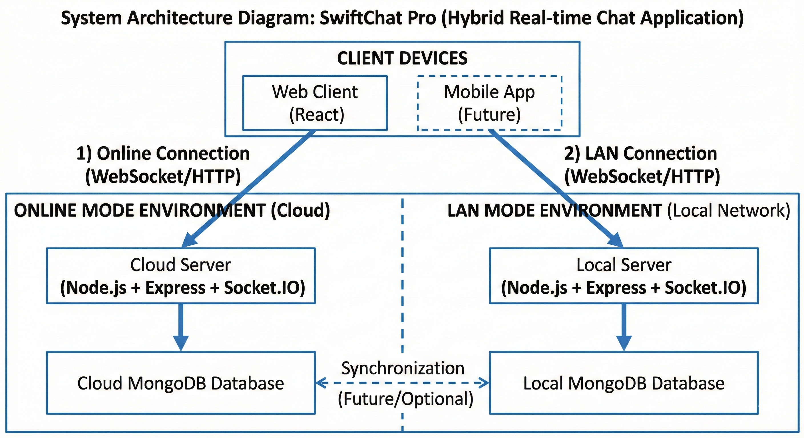

# Software Requirements Specification (SRS)
## SwiftChat Pro – Hybrid Full-Stack Real-Time Chat Application

---

## 1. Introduction

SwiftChat Pro is a hybrid real-time communication platform designed to support both **online (internet-based)** and **offline (LAN-based)** messaging. The system allows users connected through the same local network or through the internet to exchange messages instantly using web and future mobile clients.

The application demonstrates full-stack development concepts, real-time communication, and client-server architecture.

---

## 2. Purpose

The purpose of this document is to define the functional and non-functional requirements of SwiftChat Pro. This document serves as a reference for developers, testers, and evaluators to understand the system behavior, scope, and limitations.

---

## 3. Scope

SwiftChat Pro provides the following features:

- Real-time text messaging
- Hybrid communication (Online + LAN mode)
- User authentication
- Online user list
- Responsive web interface

The project is developed for academic purposes and can be extended into a production-ready system.

---

## 4. System Overview

SwiftChat Pro follows a **client-server architecture**. Frontend clients communicate with backend servers using REST APIs and WebSockets.

Two deployment modes are supported:

1. **Online Mode** – Cloud-hosted server
2. **LAN Mode** – Local server within the same network

MongoDB is used for data storage.

### System Architecture Diagram

---

## 5. Users of the System

- General Users
- System Administrator (Developer)

---

## 6. Functional Requirements

**FR1:** The system shall allow users to register using a unique username.  
**FR2:** The system shall allow users to login securely.  
**FR3:** The system shall support real-time message delivery.  
**FR4:** The system shall support online (internet-based) chat.  
**FR5:** The system shall support offline LAN-based chat.  
**FR6:** The system shall display a list of online users.  
**FR7:** The system shall allow users to logout safely.

---

## 7. Non-Functional Requirements

### Performance
- Message delivery time should be less than 1 second.

### Security
- Password encryption
- Secure authentication

### Reliability
- System should handle multiple concurrent users.

### Scalability
- Architecture should support future expansion.

### Usability
- Simple and user-friendly interface.

---

## 8. Hardware Requirements

- PC/Laptop or Smartphone
- Minimum 4GB RAM
- LAN or Internet connection

---

## 9. Software Requirements

- Node.js
- Express.js
- Socket.IO
- MongoDB
- React.js
- Git & GitHub
- Visual Studio Code

---

## 10. Assumptions and Constraints

### Assumptions
- Users have access to modern browsers.
- Users are connected to LAN or internet.

### Constraints
- Limited development timeline
- Academic project scope

---

## 11. Future Enhancements

- File sharing
- Voice and video calling
- End-to-end encryption
- Group chats
- Push notifications